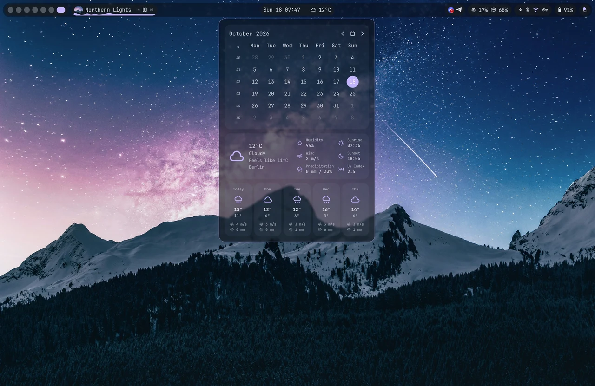
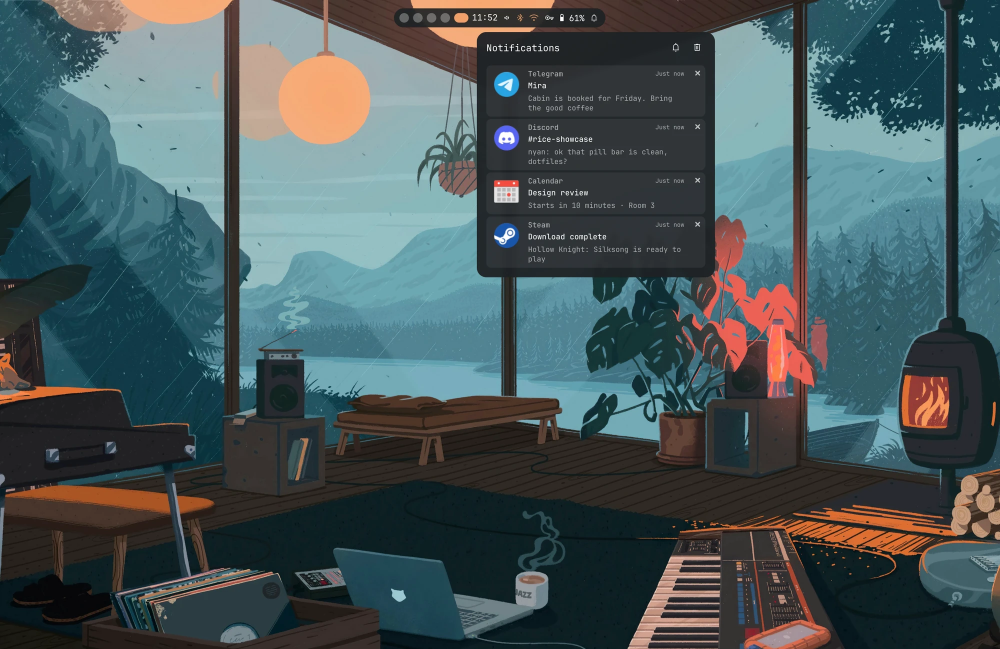
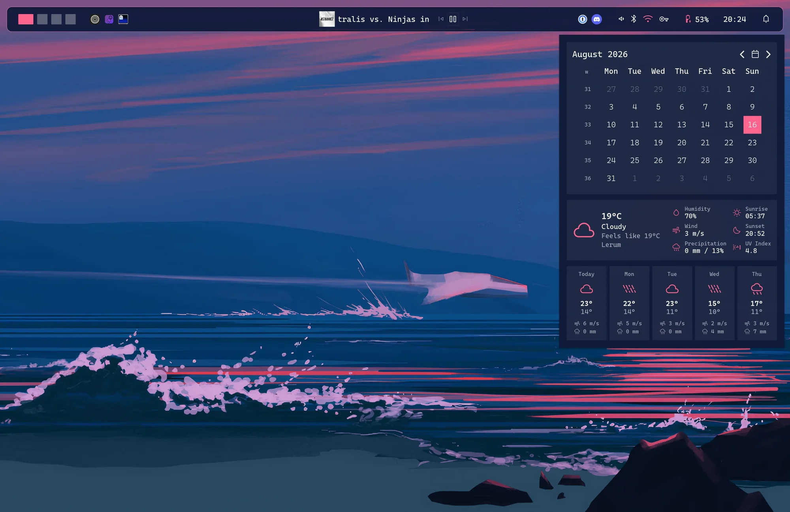
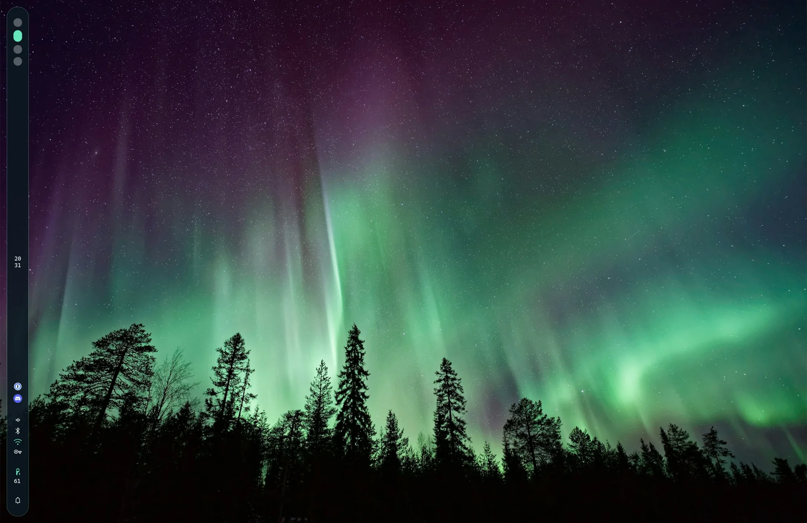
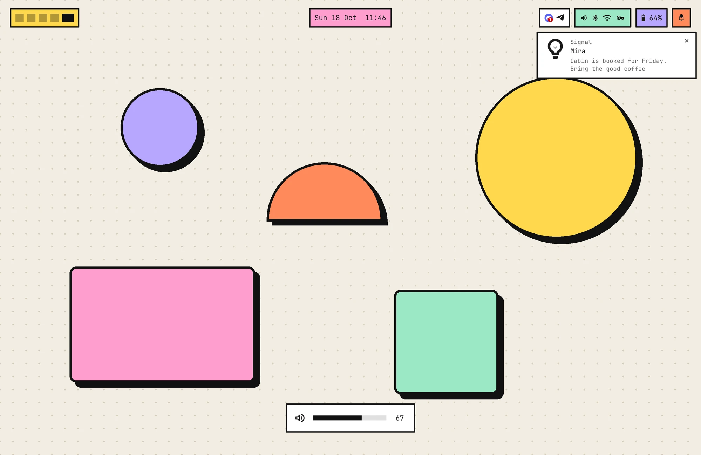
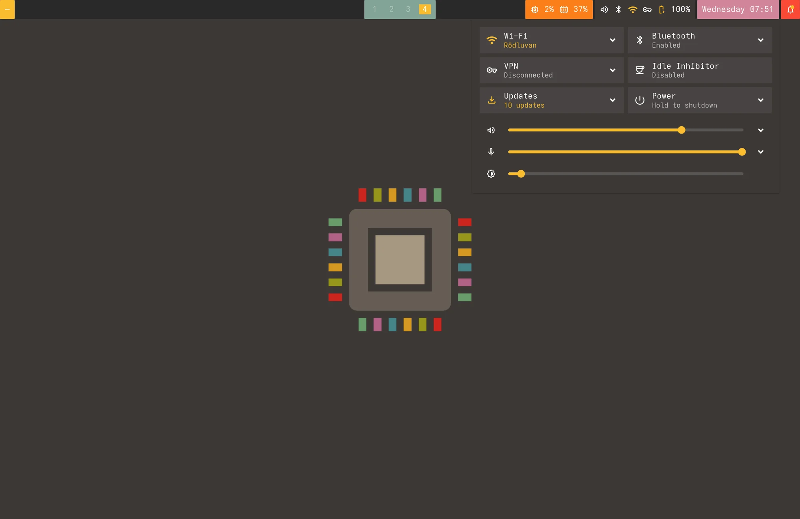
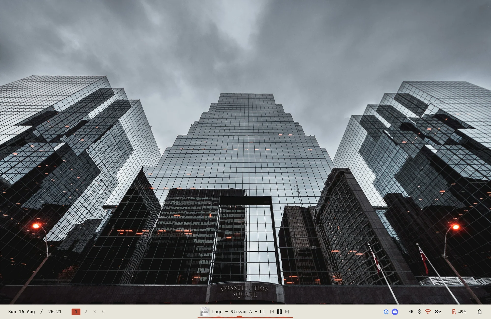

# VibePanel

<p align="center">
  <b>A Wayland panel with notifications, quick settings and OSD in one Rust binary.</b>
</p>

<p align="center">
  <a href="https://github.com/prankstr/vibepanel/stargazers"></a>
  <a href="https://github.com/prankstr/vibepanel/releases"></a>
  <a href="https://aur.archlinux.org/packages/vibepanel-bin"></a>
</p>

<p align="center">
  <picture>
    <source media="(prefers-reduced-motion: no-preference)" srcset="assets/screenshots/looks.webp">
    
  </picture>
</p>

<p align="center">
  <a href="#install">Install</a> ·
  <a href="#configure">Configure</a> ·
  <a href="#widgets">Widgets</a> ·
  <a href="https://github.com/prankstr/vibepanel/wiki">Wiki</a> ·
  <a href="CHANGELOG.md">Changelog</a>
</p>

VibePanel is a batteries-included Wayland panel built with Rust and GTK4. It combines a configurable bar, notifications, quick settings and OSD, while leaving the rest of the desktop like launchers, lock screens, wallpaper and idle management to your preferred tools. It runs on [Hyprland](https://github.com/hyprwm/Hyprland), [Niri](https://github.com/niri-wm/niri), [Sway](https://github.com/swaywm/sway), [MangoWC](https://github.com/mangowm/mango), [Miracle WM](https://github.com/miracle-wm-org/miracle-wm), [Scroll](https://github.com/dawsers/scroll) and most other Wayland compositors.

## What you get

- **Bar** – top, bottom, left or right, with optional auto-hide. Islands, groups or a classic full-width bar.
- **Notifications** – built-in notification daemon with toasts, a notification center and Do Not Disturb.
- **OSD** – on-screen display for volume and brightness.
- **Quick settings** – Wi-Fi (with QR sharing), Ethernet, cellular, Bluetooth, VPN, per-app audio, microphone, brightness, idle inhibitor, updates and power actions.
- **Polkit agent** – opt-in password prompts for privileged actions.
- **Wallpaper theming** – Material You palette from your wallpaper, light or dark picked automatically.
- **CLI** – volume, brightness, media, popovers and bar visibility, ready for keybinds.
- **Simple configuration** – works without a config file. Customize with TOML, changes apply on save. CSS when you want more control.

## Make it yours

Same panel, different vibe. Each setup below is 20–40 lines of TOML, no CSS.

<table align="center">
  <tr>
    <td><a href="assets/screenshots/pill_top_bar_desktop.webp"></a></td>
    <td><a href="assets/screenshots/sunset_top_bar_desktop.webp"></a></td>
    <td><a href="assets/screenshots/aurora_side_bar_desktop.webp"></a></td>
  </tr>
  <tr>
    <td><a href="assets/screenshots/brutal_top_bar_desktop.webp"></a></td>
    <td><a href="assets/screenshots/gruvbox_desktop.webp"></a></td>
    <td><a href="assets/screenshots/light_bottom_bar_desktop.webp"></a></td>
  </tr>
</table>

- **Theme modes** – `dark`, `light`, `gtk`, or `auto` to follow your wallpaper.
- **Colors** – accent, bar, widget and per-widget backgrounds, opacity and outlines from TOML.
- **Layout** – bar position, size, spacing, roundness and widget groups that share a background.
- **Blur** – native background blur on compositors that support `ext-background-effect-v1`.
- **CSS** – every surface exposes CSS variables and classes when TOML isn't enough.

See [Theming](https://github.com/prankstr/vibepanel/wiki/Theming) for details.

## Widgets

- **Bar & windows**: [Workspaces](https://github.com/prankstr/vibepanel/wiki/Widgets-Workspaces), [Window title](https://github.com/prankstr/vibepanel/wiki/Widgets-Window-Title), [Taskbar](https://github.com/prankstr/vibepanel/wiki/Widgets-Taskbar), [Keyboard layout](https://github.com/prankstr/vibepanel/wiki/Widgets-Keyboard-Layout), [Mango layout](https://github.com/prankstr/vibepanel/wiki/Widgets-Mango-Layout), [Spacer](https://github.com/prankstr/vibepanel/wiki/Widgets-Spacer)
- **System**: [CPU](https://github.com/prankstr/vibepanel/wiki/Widgets-CPU), [Memory](https://github.com/prankstr/vibepanel/wiki/Widgets-Memory), [GPU](https://github.com/prankstr/vibepanel/wiki/Widgets-GPU), [Disk](https://github.com/prankstr/vibepanel/wiki/Widgets-Disk), [Network speed](https://github.com/prankstr/vibepanel/wiki/Widgets-Network-Speed), [Battery](https://github.com/prankstr/vibepanel/wiki/Widgets-Battery), [Updates](https://github.com/prankstr/vibepanel/wiki/Widgets-Updates), [Tray](https://github.com/prankstr/vibepanel/wiki/Widgets-Tray)
- **Media & info**: [Media](https://github.com/prankstr/vibepanel/wiki/Widgets-Media), [Clock](https://github.com/prankstr/vibepanel/wiki/Widgets-Clock), [Weather](https://github.com/prankstr/vibepanel/wiki/Widgets-Weather), [Notifications](https://github.com/prankstr/vibepanel/wiki/Widgets-Notifications)
- **Controls**: [Quick settings](https://github.com/prankstr/vibepanel/wiki/Widgets-Quick-Settings), [Custom](https://github.com/prankstr/vibepanel/wiki/Widgets-Custom) (your own scripts, buttons and indicators)

Most widgets open a popover: calendar and weather forecast, system graphs, media controls with album art and visualizer, battery details with power profiles. Any widget can take right/middle-click commands and a `show_if` condition. See the [Widgets wiki](https://github.com/prankstr/vibepanel/wiki/Widgets).

## Install

> [!NOTE]
> VibePanel supports Wayland compositors that provide the layer-shell protocol; see [Compositors](https://github.com/prankstr/vibepanel/wiki/Compositors).
>
> VibePanel requires **GTK 4.22** or newer since 0.17. On distros with older GTK (Fedora 43, Debian 13, Ubuntu 24.04) stay on [0.16.x](https://github.com/prankstr/vibepanel/releases/tag/v0.16.1).

<details open>
<summary><b>Arch Linux (AUR)</b></summary>

Pick one:

```sh
yay -S vibepanel-bin   # prebuilt binary
yay -S vibepanel       # build latest release
yay -S vibepanel-git   # build main
```

</details>

<details>
<summary><b>Fedora</b></summary>

With [Terra](https://terrapkg.com/):

```sh
sudo dnf install --nogpgcheck --repofrompath 'terra,https://repos.fyralabs.com/terra$releasever' terra-release
sudo dnf install vibepanel
```

Or with COPR:

```sh
sudo dnf copr enable prankstr/vibepanel
sudo dnf install vibepanel
```

</details>

<details>
<summary><b>Nix</b></summary>

```sh
nix run github:prankstr/vibepanel             # try it
nix profile install github:prankstr/vibepanel # install
```

</details>

<details>
<summary><b>Other distros</b></summary>

Install the [runtime dependencies](https://github.com/prankstr/vibepanel/wiki/Installation#runtime-dependencies), then:

```sh
curl -LO https://github.com/prankstr/vibepanel/releases/latest/download/vibepanel-x86_64-unknown-linux-gnu
install -Dm755 vibepanel-x86_64-unknown-linux-gnu ~/.local/bin/vibepanel
```

Or [build from source](https://github.com/prankstr/vibepanel/wiki/Installation#from-source).

</details>

Then run it:

```sh
vibepanel
```

To start it automatically, add the line for your compositor to its config:

```
# Hyprland (hyprland.conf), MangoWC (config.conf)
exec-once = vibepanel

# Sway (sway/config)
exec vibepanel

// Niri (config.kdl)
spawn-at-startup "vibepanel"
```

See the [Installation wiki](https://github.com/prankstr/vibepanel/wiki/Installation) for optional dependencies.

Workspaces, window title, keyboard layout, taskbar and Mango layout depend on compositor IPC and support varies, see [Compositors](https://github.com/prankstr/vibepanel/wiki/Compositors).

## Configure

No config is needed. To customize, start from the example:

```sh
mkdir -p ~/.config/vibepanel
vibepanel --print-example-config > ~/.config/vibepanel/config.toml
```

A small config:

```toml
[bar]
size = 32

[widgets]
left = ["workspaces", "window_title"]
center = ["media"]
right = ["tray", "quick_settings", "battery", "clock", "notifications"]

[theme]
mode = "dark"
accent = "#adabe0"
```

Changes apply on save. Run `vibepanel --check-config` to validate. All options are in the [Configuration wiki](https://github.com/prankstr/vibepanel/wiki/Configuration).

### Keybinds

The CLI talks to the running panel, so media keys show the OSD:

```ini
# Hyprland
bindel = , XF86AudioRaiseVolume, exec, vibepanel volume inc
bindel = , XF86AudioLowerVolume, exec, vibepanel volume dec
bindel = , XF86MonBrightnessUp, exec, vibepanel brightness inc
bindel = , XF86MonBrightnessDown, exec, vibepanel brightness dec
bind = SUPER, S, exec, vibepanel popover toggle quick-settings
bind = SUPER, B, exec, vibepanel bar toggle
```

```kdl
// Niri, inside binds { }
XF86AudioRaiseVolume allow-when-locked=true { spawn "vibepanel" "volume" "inc"; }
Mod+S { spawn "vibepanel" "popover" "toggle" "quick-settings"; }
```

Full list in the [CLI wiki](https://github.com/prankstr/vibepanel/wiki/CLI).

## Status

VibePanel is pre-1.0. Config options and defaults can change between minor releases, so check the [changelog](CHANGELOG.md) when upgrading.

Much of the code is written with the help of AI tools. I review every change and use VibePanel daily on multiple machines.

## Contributing

Bug reports and feature requests go in [issues](https://github.com/prankstr/vibepanel/issues), and pull requests are welcome. See [CONTRIBUTING.md](CONTRIBUTING.md) before opening a PR.

If you find VibePanel useful, a star helps others discover it <3

## License

[MIT](LICENSE). The bundled [Material Symbols](https://github.com/google/material-design-icons) font is © Google, licensed under [Apache-2.0](assets/fonts/LICENSE).
